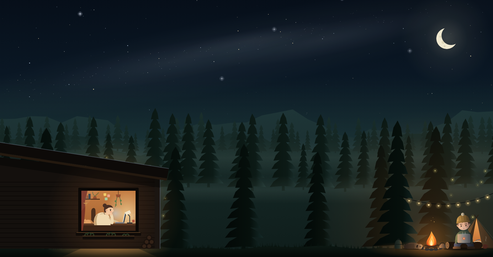
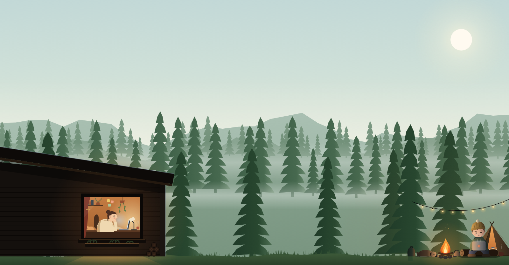

# Forest Cabin 🌲🔥

A cozy forest-cabin theme mod for the **Claude Code desktop app**.



- **Backdrop**: a night pine forest behind the chat, two people working remotely. On the left, through a big lit cabin window, a woman types with her chin in one hand, sticky notes on the wall and a cat asleep on the desk. On the right, under string lights, a man in a beanie works on the laptop on his knees by the campfire, a notebook beside him, a dog asleep by the fire and a tent glowing behind.
- **Motion**: the fire flickers, sparks rise, the string lights breathe, both of them type, fireflies drift, stars twinkle and fog slides between the trees. It is all slow on purpose. With your system's reduced-motion setting on, the scene rests as a still picture.
- **Colors**: wood-toned surfaces with campfire-orange accents. Made for dark mode; in light mode the forest turns to day around the same scene.
- **Messages**: sit on near-solid wood-toned cards so the text stays readable over the scene.
- **Sound (optional)**: crackling logs, wind in the pines and far crickets, plus soft wooden cues. It stays off until you press the speaker in the session's title bar.



## Install

At the prompt of a Claude Code terminal session:

```text
/plugin install forest-cabin --marketplace sometimesstudios/forest-cabin
```

Answer `y` to add the marketplace, then choose a scope (user scope is the first choice).

From a shell:

```bash
claude plugin install forest-cabin --marketplace sometimesstudios/forest-cabin
```

In the desktop app, where `/plugin` does not run: click **+** next to the prompt box, then **Plugins**, **Add marketplace** with `sometimesstudios/forest-cabin`, then **Add plugin**.

The theme shows from the next session you start.

## Requirements

- The Claude Code **desktop app** (Code tab). The terminal keeps its own colors and draws no backdrop.
- Claude Code **2.1.324 or later** for the colors. On older builds that refuse sound or message styles, the mod falls back to colors and backdrop alone.

## Remove

1. Turn the mod off or uninstall it under **Manage plugins** in the desktop app.
2. Start a new session.
3. If the colors stay, open Settings, search for "code appearance" and choose **Remove colors**.

## What it does and doesn't do

At session start it sets the theme once. It draws the backdrop when the desktop or mobile app asks for it. It reads no prompts, files or tool calls, runs no processes and sends nothing over the network.

## Change it

- `hooks/colors.ts` sets the palette.
- `hooks/register.tsx` sets the backdrop glass, the sound and the message styles.
- `hooks/scene.ts` is generated. Edit `tools/gen-scene.mjs` and run:

```bash
node tools/gen-scene.mjs hooks/scene.ts
```

To try your changes, run `claude --plugin-dir .` from this folder.

---

## 한국어 안내

Claude Code **데스크탑 앱**을 숲속 오두막·캠핑 분위기로 바꿔 주는 테마 mod예요.

- **배경**: 밤의 소나무 숲에서 두 사람이 원격으로 일하는 디지털 노마드 장면이에요. 왼쪽 오두막의 큰 창 안에서는 여자가 한 손으로 턱을 괴고 타이핑해요. 벽에는 메모지가 붙어 있고, 책상 위에서는 고양이가 자요. 오른쪽 전구 줄 아래에서는 비니 쓴 남자가 모닥불 옆에서 무릎 위 노트북으로 일해요. 옆에는 노트, 불 옆에는 잠든 강아지, 뒤에는 불빛이 새어 나오는 텐트가 있어요.
- **움직임**: 모닥불이 일렁이고, 전구가 은은하게 숨 쉬고, 두 사람이 타이핑하고, 반딧불이가 떠다니고, 별이 반짝이고, 안개가 흘러요. 모두 일부러 천천히 움직여요.
- **색**: 나무색 화면에 모닥불 주황 강조색을 써요. 다크 모드에 맞춰 그렸고, 라이트 모드에서는 같은 장면의 숲이 낮으로 바뀌어요.
- **소리(선택)**: 장작 타는 소리, 솔바람, 먼 귀뚜라미 소리예요. 세션 제목줄의 스피커를 눌러야 나와요.

**설치**: 터미널의 Claude Code에서 아래를 입력하세요.

```text
/plugin install forest-cabin --marketplace sometimesstudios/forest-cabin
```

**지우기**: 데스크탑 앱 Manage plugins에서 끄거나 지운 뒤 새 세션을 여세요. 색이 남으면 설정에서 "code appearance"를 검색해 Remove colors를 누르세요.

## License

MIT, except `hooks/make-colors.js` and `hooks/make-colors.d.ts`. Those two files are the color helper that Claude Code's plugin-authoring skill hands to mod authors to copy unchanged. They are included as they are and are not covered by this repository's license.
